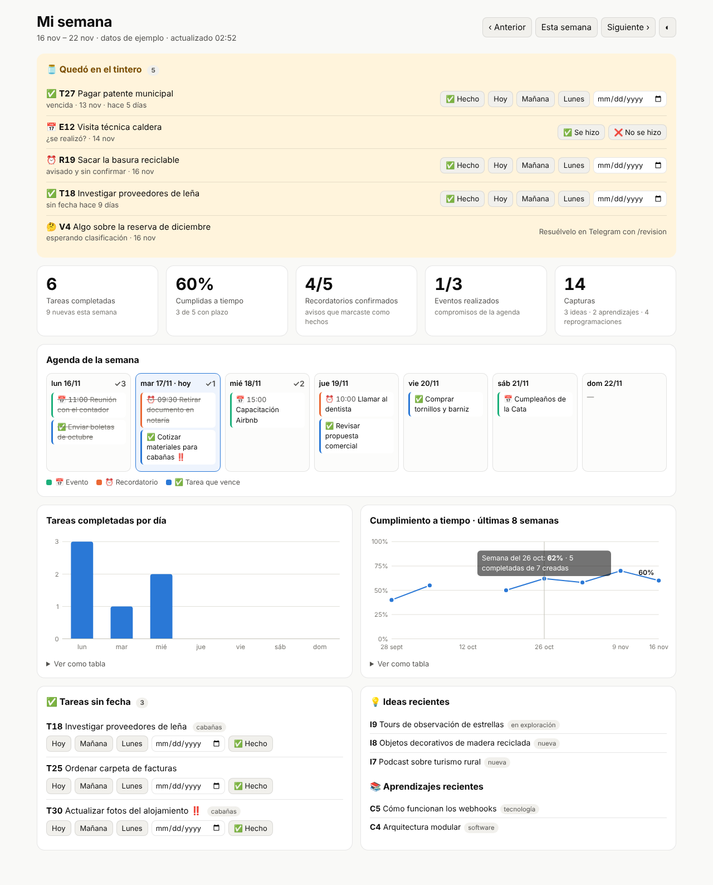
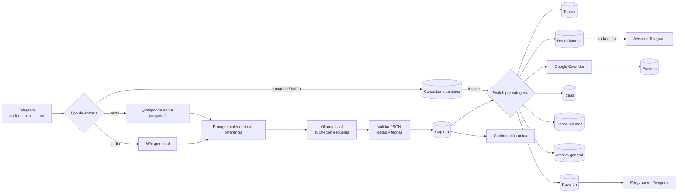

# Asistente TDAH · tu segundo cerebro en Telegram

Le mandas un audio a tu bot de Telegram con lo que tengas en la cabeza: *"mañana tengo que cotizar materiales, el jueves a las 11 tengo reunión con el contador y se me ocurrió hacer tours de estrellas en las cabañas"*. El asistente lo transcribe, entiende qué es cada cosa, la guarda donde corresponde y te confirma qué hizo. Después **te lo vuelve a poner delante**: avisos a la hora justa, un plan cada mañana, un cierre cada noche y un resumen el domingo. Lo que se te pasó queda en **"el tintero"** para que lo reprogrames con un toque.

Todo corre en tu computador: n8n, PostgreSQL, **Ollama** (clasificación) y **Whisper** (transcripción). Tus audios no salen a servicios de IA externos.



---

## Cómo se usa en el día a día

Pensado para no tener que acordarte de usarlo.

| Momento | Qué pasa | Qué haces tú |
|---|---|---|
| Cuando se te ocurre algo | Mandas un audio o texto | Nada más. Recibes la confirmación con códigos (T12, R3, E5…) |
| A la hora de un recordatorio | 🔔 Te llega el aviso con botones | **✅ Hecho**, **⏰ +1 h** o **📅 Mañana**. Si no tocas nada, te insiste 2 veces |
| 08:00 | ☀️ Plan del día + lo que quedó atrasado | Tocas ✅ / Mañana / Lunes en lo atrasado |
| 21:00 | 🌙 Cierre: "¿qué pasó con esto?" | Marcas lo hecho o lo mueves |
| Domingo 19:00 | 📊 Tu semana: rendimiento, tintero y lo que viene | Revisas el panel en `http://localhost:8080` |

Si algo quedó en la categoría equivocada: `/mover T12 idea`. Si al asistente le falta un dato (por ejemplo, la hora de un recordatorio), **te pregunta** y tú respondes a ese mensaje.

### Comandos de Telegram

| Ver | Actuar |
|---|---|
| `/hoy` `/semana` `/tintero` | `/hecho T12` `/encurso T12` `/pendiente T12` |
| `/tareas` `/recordatorios` `/eventos` | `/reprogramar T12 viernes` · `/reprogramar R3 mañana 9` · `/reprogramar R3 +30m` |
| `/ideas` `/conocimientos webhooks` `/otros` | `/cancelar R3` · `/cancelar E2` (también lo quita de Google Calendar) |
| `/revision` `/buscar palabra` `/ver T12` `/panel` | `/mover T12 idea` · `/idea I4 exploracion` |

Códigos: **T** tarea · **R** recordatorio · **E** evento · **I** idea · **C** conocimiento · **O** otros · **V** en revisión.

---

## Cómo funciona



| Workflow (carpeta `n8n/`) | Qué hace |
|---|---|
| `1-entrada-telegram.json` | Recibe todo lo que llega del bot: audio → Whisper → Ollama → validación → **Switch de 6 categorías + revisión** → confirmación. También comandos, botones y reclasificación |
| `2-recordatorios-y-resumenes.json` | Cada minuto envía recordatorios vencidos. 08:00, 21:00 y domingo 19:00 envía los resúmenes |
| `3-api-panel.json` | Webhooks que alimentan el panel semanal (protegidos con token) |

### Las seis categorías y dónde quedan

| Categoría | Destino | Campos |
|---|---|---|
| `tarea` | Tabla `tareas` (bandeja consultable con `/tareas`) | id, título, descripción, fecha de captura, fecha límite, prioridad, estado (pendiente / en curso / completada), proyecto, etiquetas |
| `recordatorio` | Tabla `recordatorios` + envío programado por n8n a Telegram | id, mensaje, fecha, hora, estado, fecha de creación, confirmación de ejecución (`confirmado_en`) |
| `evento` | **Google Calendar** (nodo oficial de n8n) + copia en `eventos` | id, nombre, descripción, fecha, hora de inicio, hora de término, lugar, participantes |
| `idea` | Tabla `ideas` (biblioteca separada) | id, título, descripción completa, fecha de captura, área temática, proyecto, potencial aplicación, etiquetas, estado (nueva / en exploración / en desarrollo / descartada) |
| `conocimiento` | Tabla `conocimientos` con búsqueda de texto completo en español | id, título, concepto principal, explicación estructurada, fecha de captura, fuente, área temática, posibles aplicaciones, etiquetas |
| `otros` | Tabla `otros` (archivo general) | id, título, transcripción, resumen, fecha, tema, etiquetas |

Además: `capturas` guarda **cada audio con su transcripción original intacta** y el JSON del modelo; `revision` guarda lo dudoso; `vinculos` relaciona registros (una tarea que nace de una idea); `reclasificaciones` guarda el historial de cambios manuales.

### Reglas de clasificación (sección 17) y dónde se cumplen

| Regla | Cómo |
|---|---|
| Un audio puede tener varias categorías / registros separados | El prompt lo exige; el validador acepta hasta 15 registros por audio |
| Mantener la relación entre registros del mismo audio | Todos guardan `captura_id`; `/ver T12` muestra "del mismo audio". Idea + acción concreta → dos registros enlazados (`relacionado_con`) |
| Conservar la transcripción original | `capturas.transcripcion_original` se toma de Whisper, nunca de lo que reescribe el modelo |
| Corregir errores de reconocimiento | Campo `transcripcion_corregida` |
| No inventar fechas, horarios, fuentes, prioridades | Prompt + validador: fecha/hora inválida se descarta; prioridad no dicha queda vacía; recordatorio sin hora o evento sin día **no se crean**: pasan a revisión con una pregunta |
| Incertidumbre → revisión | `confianza < 0.6`, `requiere_confirmacion` o categoría desconocida → bandeja de revisión con botones de categoría |
| No confundir ideas/tareas/recordatorios/eventos/conocimientos | Criterios y ejemplos explícitos en `prompts/clasificador.md` |
| Cambiar la clasificación desde Telegram | `/mover CÓDIGO categoría` o botones; el registro vuelve a pasar por la validación y el Switch (un evento movido se crea en Calendar) |
| Validar el JSON antes de distribuir | Nodo **Validar JSON** (`src/lib/clasificacion.js`): repara JSON envuelto, normaliza categorías y estados, valida fechas/horas. Si el JSON es irrecuperable, el mensaje completo va a revisión: **nada se descarta** |
| No clasificar solo por palabras clave | Clasificación semántica con Ollama (`qwen2.5:7b` por defecto) y salida forzada con esquema JSON (`format`) |

Las fechas relativas ("el martes", "pasado mañana") se resuelven con un **calendario de referencia** que se le entrega al modelo, y los avisos relativos ("en dos horas") los calcula el validador, no el modelo. Así un modelo local pequeño no se equivoca con la aritmética de fechas.

---

## Instalación (una vez, unos 20 minutos)

Necesitas Docker Desktop, unos 10 GB libres y, idealmente, 16 GB de RAM.

1. **Bot de Telegram:** en Telegram abre `@BotFather` → `/newbot` → copia el token.
2. **Túnel HTTPS** (Telegram solo envía mensajes a direcciones HTTPS): crea una cuenta gratis en ngrok.com, copia tu *authtoken* y reclama tu dominio fijo gratuito en *Domains*.
3. **Configura:**
   ```bash
   cd asistente-tdah
   cp .env.example .env
   # completa TELEGRAM_BOT_TOKEN, NGROK_AUTHTOKEN, NGROK_DOMAIN,
   # POSTGRES_PASSWORD, N8N_ENCRYPTION_KEY y PANEL_TOKEN (puedes generarlas con: openssl rand -hex 24)
   ```
4. **Arranca:**
   ```bash
   docker compose --profile tunel up -d
   ```
   La primera vez descarga el modelo de Ollama (~4,7 GB) y el de Whisper. Revisa el avance con `docker compose logs -f ollama-modelo`.
5. **Activa tu chat:** escríbele cualquier cosa a tu bot. Te responde con tu número de chat → ponlo en `TELEGRAM_CHAT_ID` del `.env` → `docker compose up -d`. Desde ahí el bot solo te responde a ti.
6. **Google Calendar** (puede ser después):
   - En Google Cloud Console crea un proyecto, habilita *Google Calendar API* y crea un cliente OAuth tipo *Aplicación web* con la URI de redirección `https://TU_DOMINIO_NGROK/rest/oauth2-credential/callback`.
   - Pon `GOOGLE_CLIENT_ID` y `GOOGLE_CLIENT_SECRET` en el `.env` y ejecuta `docker compose up -d`.
   - Abre n8n en `http://localhost:5678` → *Credentials* → **Google Calendar Asistente** → *Sign in with Google*.
   - Mientras no esté conectado, los eventos igual se guardan en la base y la confirmación te avisa que no llegaron a Calendar.
7. **Panel:** `http://localhost:8080`. Para verlo sin datos reales: `http://localhost:8080/?demo`.

> n8n se importa solo: credenciales de Postgres y Telegram desde el `.env`, los tres workflows y su activación. Si editas un workflow en n8n, no se sobrescribe al reiniciar (salvo que pongas `REIMPORTAR_WORKFLOWS=true`).

### Ajustes útiles
- **Modelo:** `OLLAMA_MODEL=qwen2.5:7b` funciona bien en español. Con poca RAM prueba `qwen2.5:3b`; con GPU, `qwen2.5:14b` clasifica mejor.
- **Whisper:** `WHISPER_MODELO=small` es un buen equilibrio; `medium` entiende mejor audios con ruido.
- **Horarios de los resúmenes:** se cambian en el workflow 2 (nodos *Mañana 08:00*, *Noche 21:00*, *Domingo 19:00*).
- **Zona horaria:** `ZONA_HORARIA` en el `.env`.

---

## Estructura

```
asistente-tdah/
├── docker-compose.yml          Postgres, n8n, Ollama, Whisper, panel (nginx) y túnel
├── .env.example
├── db/                          Esquema, guardado por categoría, comandos, resúmenes y panel (SQL)
├── prompts/clasificador.md      Prompt del clasificador (con ejemplo completo)
├── src/lib/clasificacion.js     Validador del JSON (se incrusta en n8n y se prueba con Node)
├── src/nodos/                   Código de cada nodo Code
├── tools/build-workflows.js     Genera n8n/*.json a partir de src/ y prompts/
├── n8n/                         Workflows listos para importar
├── dashboard/index.html         Panel semanal
├── infra/                       Inicialización de n8n y configuración de nginx
└── tests/                       Pruebas del validador, de la base y de integración con n8n
```

Si cambias el prompt o el código en `src/`, regenera los workflows con `node tools/build-workflows.js`.

## Pruebas

```bash
node tests/test-validador.js                                   # 19 pruebas del validador
PGHOST=127.0.0.1 PGUSER=postgres tests/test-sql.sh             # escenario completo en PostgreSQL
PGHOST=127.0.0.1 PGUSER=postgres N8N_BIN=$(which n8n) tests/integracion/run.sh
```

La prueba de integración levanta **n8n real** con **PostgreSQL real** e imita Telegram, Whisper y Ollama con un servidor falso (`tests/integracion/mock.js`). Recorre 31 verificaciones: un audio con cuatro categorías, el recordatorio sin hora que pide aclaración y se completa al responder, el JSON inválido que no pierde información, botones, comandos, `/mover`, el bloqueo de chats desconocidos, la API del panel y el envío programado de recordatorios sin duplicados.

## Decisiones de diseño

- **Base de datos en vez de hojas de cálculo:** permite consultas por categoría, búsqueda de texto y un tintero confiable.
- **La lógica vive en funciones SQL** (`comando_telegram`, `confirmacion`, `panel_semanal`…): los workflows quedan cortos y legibles, y la lógica se puede probar sin n8n.
- **La confirmación es una sola:** el Switch termina todas sus ramas antes de que se arme la confirmación (orden de ejecución v1 de n8n), que lee de la base lo que realmente quedó guardado.
- **Las tareas no van a Google Calendar.** Solo los eventos.
- **Prioridad vacía si no se dijo.** El esquema de ejemplo trae "media", pero ponerla por defecto sería inventar un dato (regla 6).
